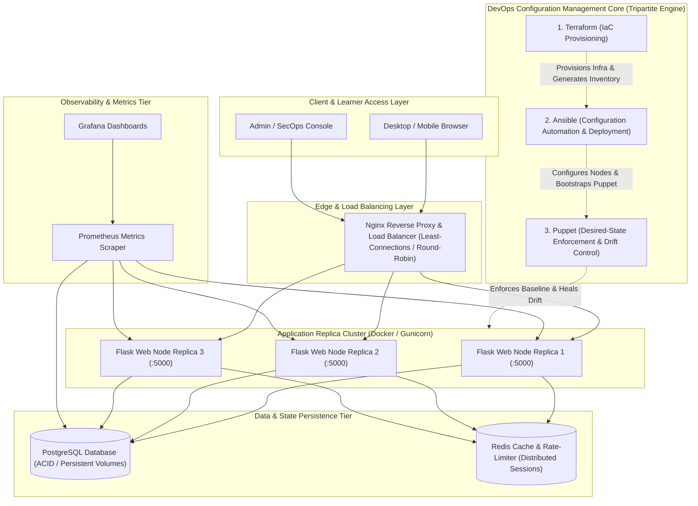
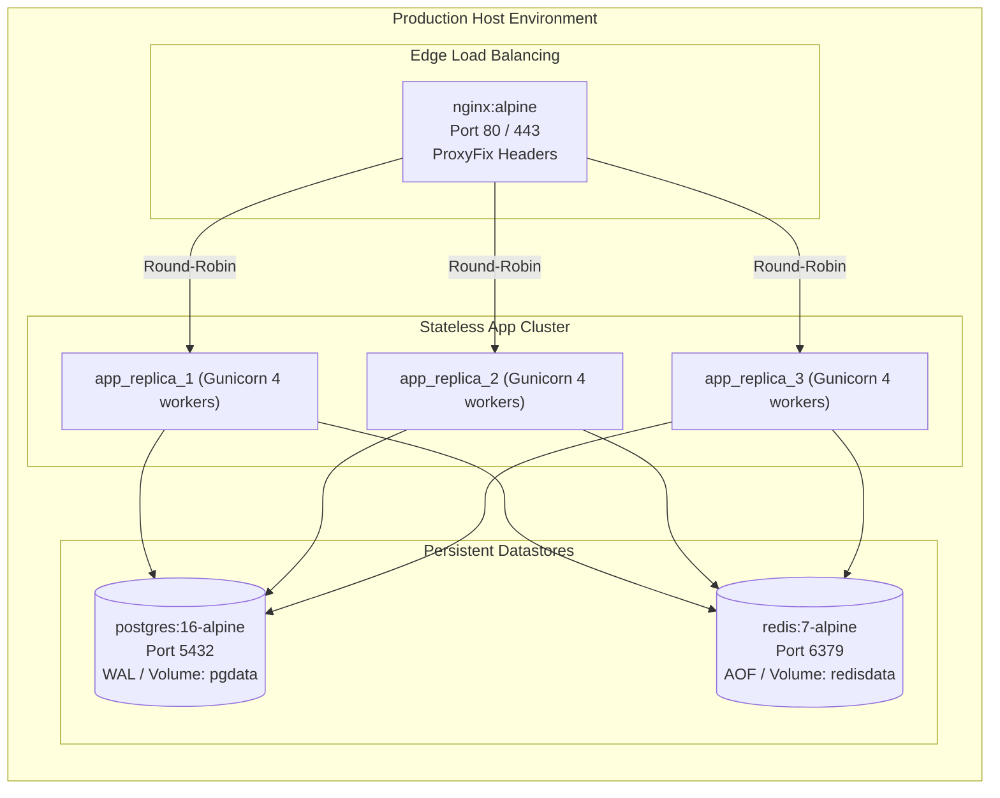

# HUMAN FIREWALL — SYSTEM ARCHITECTURE DOCUMENTATION
**Enterprise & Academic Architecture Blueprint | DevOps Advanced Configuration Management**

---

## 1. Architectural Philosophy & Overview

Human Firewall is an enterprise-grade cybersecurity awareness and training platform built with a high-resilience, modular micro-architecture. It adheres to strict Separation of Concerns (SoC) across infrastructure provisioning, automation configuration, desired-state enforcement, container orchestration, and application runtime.

---

## 2. Core DevOps Configuration Management Engine (Tripartite Hierarchy)

The project establishes a clear, non-overlapping hierarchy among the three primary DevOps technologies:

### 2.1 Technology 1: Terraform (Infrastructure as Code)
- **Role**: Declarative infrastructure provisioning.
- **Scope**: Creates virtual compute instances, VPCs, subnets, internet gateways, firewall rules, security groups, and SSH keys.
- **Output Hand-off**: Generates structured machine-readable outputs and dynamic inventory files (`inventory/hosts.ini` and `inventory/hosts.json`) consumed by Ansible.
- **Environments**: Strict workspace separation across `dev/`, `staging/`, and `production/`.

### 2.2 Technology 2: Ansible (Configuration Management & Orchestration)
- **Role**: Imperative and idempotent machine configuration, package provisioning, and application rollout.
- **Scope**:
  - Operating system baseline updates and security hardening (`sysctl`, non-root user creation).
  - UFW / Iptables firewall configuration.
  - Docker Engine and Docker Compose installation.
  - Application stack deployment (pulling images, configuring environment variables, running migrations).
  - Bootstrapping and activating the Puppet agent service.
- **Structure**: 9 focused roles (`common`, `security`, `users`, `firewall`, `docker`, `nginx`, `application`, `database`, `monitoring`).

### 2.3 Technology 3: Puppet (Desired-State Configuration Management)
- **Role**: Continuous declarative state compliance, audit enforcement, and configuration drift correction.
- **Scope**:
  - Enforces system service states (ensuring Nginx, Docker, SSH are running and enabled).
  - Enforces file permissions and configurations (e.g. `/etc/ssh/sshd_config`, `/etc/security/limits.conf`, application directories).
  - Detects unauthorized manual modifications ("configuration drift") and restores the declared state without redeploying the application.
- **Structure**: Manifests (`site.pp`), reusable modules, Hiera data layers, and automated drift detection scripts.

---

## 3. Containerized High-Availability Architecture

### 3.1 Nginx Reverse Proxy & Load Balancer
- Upstream pool distributes incoming traffic across application replicas using least-connections or round-robin algorithms.
- Enforces strict HTTP security headers, connection timeouts, and client request size limits.
- Proxies `X-Forwarded-For`, `X-Forwarded-Proto`, and `X-Forwarded-Host` headers down to Flask.

### 3.2 Flask Replicas (Gunicorn WSGI)
- Multi-stage Docker builds utilizing an unprivileged user (`appuser`, UID 10001).
- Gunicorn WSGI server configured with 4 worker processes per container and healthcheck endpoints (`/healthz`).
- Stateless design: user sessions can be distributed across any replica without session tearing.

### 3.3 PostgreSQL & Redis Persistence
- **PostgreSQL 16**: Primary relational datastore holding users, orgs, content, labs, games, and immutable XP ledgers. Connection pooling managed via SQLAlchemy `pool_pre_ping=True`.
- **Redis 7**: Centralized distributed rate-limiting backend (`Flask-Limiter`) and fast key-value cache.

---

## 4. Application Architecture & Blueprint Topology

```mermaid
graph TD
    Factory["Flask Factory (create_app)"]
    
    Factory --> AuthBP["/auth (Authentication, RBAC, Passwords)"]
    Factory --> DashboardBP["/dashboard (Learner Hub, Streaks, Leaderboard)"]
    Factory --> GamesBP["/games (30 Interactive Awareness Games)"]
    Factory --> LabsBP["/labs (100 Practical Labs & Scenarios)"]
    Factory --> LearnBP["/learn (Defense Rooms, Comics, Videos)"]
    Factory --> IncidentsBP["/what-happened (Historical Case Studies)"]
    Factory --> NewsBP["/cyber-news (Threat Intel RSS Feed)"]
    Factory --> CertsBP["/certificates (Verifiable Digital Credentials)"]
    Factory --> OrgBP["/org (Multi-Tenant B2B Management)"]
    Factory --> AdminBP["/admin (User Management & DevOps Console)"]
    Factory --> ApiBP["/api (Server-Side Answer Grading & Idempotent XP)"]
    Factory --> PublicBP["/ (Landing, About, Terms, Healthz)"]
```

---

## 5. Security & Defense-in-Depth Architecture

1. **Authentication**: Argon2id salted password hashing with transparent upgrade on verification.
2. **Access Control**: Role-based access control (RBAC) with 4 roles: `learner`, `instructor`, `admin`, `org_admin`.
3. **Session Integrity**: Session cookies with `HttpOnly=True`, `SameSite=Lax`, and `Secure=True` in production.
4. **Input & API Security**:
   - Server-side grading of all game choices, lab flags, and quiz submissions. Correct answers are never sent to the browser prior to commitment.
   - Idempotent XP transaction ledger with unique composite database constraint `(user_id, reason, reference_type, reference_id)`.
5. **Transport & Headers**: Content Security Policy (CSP), Strict-Transport-Security (HSTS), X-Content-Type-Options: nosniff, X-Frame-Options: DENY.
6. **DevOps Security**: No shell execution exposed via HTTP. Admin DevOps dashboard reads authenticated telemetry logs and structured system status files.

---

## 6. Observability & SRE Architecture

- **Prometheus Exporter**: Exposes HTTP request latency, status codes, active database connections, and memory consumption.
- **Health Probes**: Liveness probe (`/healthz`) and readiness probe (`/readyz`) testing DB and Redis connectivity.
- **Structured Audit Logging**: Non-sensitive logging of all operational events to append-only database tables and stdout streams.

